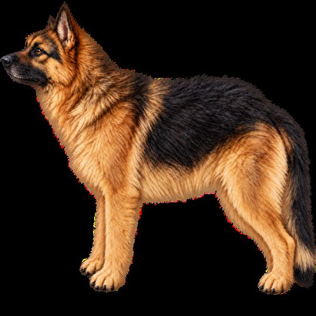

# Burebista Trapper Dog

**v0.6.5 · The Long Dark · Español / English**

[Descargar / Download](https://github.com/florynstefanache-source/BurebistaTrapperDog/releases/latest) · [English](#english)

Vista del recurso visual incluido en el mod / Preview of the visual asset included with the mod.

## Español

Un pastor alemán que te acompaña, espera, caza presas pequeñas y puede tirar del Trapper Sled. Incluye sonidos, gestos cada diez segundos, movimiento y descanso sobre una cama o saco. El perro ocupa 10 kg al guardarlo en la mochila.

Requiere **ModData**, además de MelonLoader. Para tirar del trineo instala también [Burebista Trapper Sled](https://github.com/florynstefanache-source/BurebistaTrapperSled).

| Tecla | Acción |
| --- | --- |
| Ctrl + Alt + P | Sacar / guardar perro |
| Ctrl + Alt + O | Seguir / esperar |
| Ctrl + Alt + L | Guardar en la mochila |
| Ctrl + Alt + H | Menú de caza |
| Ctrl + Alt + T | Enganchar / desenganchar trineo |
| Ctrl + Alt + B | Descansar / levantarse |

### Instalación

1. Cierra el juego. Instala MelonLoader y ejecuta el juego una vez para preparar sus carpetas.
2. Descarga el ZIP de **Releases**, no el ZIP automático del código fuente.
3. Copia todo el contenido de `Mods` del ZIP a `TheLongDark/Mods`, conservando la carpeta de recursos junto al DLL.
4. Reemplaza la versión anterior; guarda las copias antiguas fuera de `Mods`.
5. Abre el juego. Los textos cambian con el idioma del juego: español o inglés.

No necesita el antiguo `BurebistaLanguages.dll`.

### Esta versión

Traducción de descripciones, menús y mensajes según el idioma del juego. Conserva las funciones de la versión anterior. El autor ha confirmado su funcionamiento en su partida.

## English

A German Shepherd companion with follow/wait commands, small-prey hunting, sounds, gestures every ten seconds and rest on beds or bedrolls. Can tow the optional [Trapper Sled](https://github.com/florynstefanache-source/BurebistaTrapperSled). The packed dog weighs 10 kg. Requires **ModData** and MelonLoader.

| Shortcut | Action |
| --- | --- |
| Ctrl + Alt + P | Summon / pack dog |
| Ctrl + Alt + O | Follow / wait |
| Ctrl + Alt + L | Pack into inventory |
| Ctrl + Alt + H | Hunting menu |
| Ctrl + Alt + T | Hitch / unhitch sled |
| Ctrl + Alt + B | Rest / wake |

### Installation

1. Close the game. Install MelonLoader and launch the game once to prepare its folders.
2. Download the installable ZIP from **Releases**, rather than GitHub's automatic source archive.
3. Copy everything inside the ZIP's `Mods` folder into `TheLongDark/Mods`. Keep the asset folder next to the DLL.
4. Replace the previous version and keep backups outside `Mods`.
5. Launch the game. Text follows the selected game language: Spanish or English.

The old `BurebistaLanguages.dll` is not required. This version adds language support while preserving the previous gameplay features. The author has confirmed it working in their save.

## Compilar / Build

Fuente C# en `src`; requiere .NET SDK y los ensamblados locales generados por MelonLoader. / C# source is in `src`; requires the .NET SDK and local assemblies generated by MelonLoader.

`dotnet build src/BurebistaTrapperDog.csproj -c Release -p:GameDir="C:/path/to/TheLongDark"`

## Créditos / Credits

Mod de Burebista. The Long Dark pertenece a Hinterland Studio. Mod de aficionados no oficial. / Mod by Burebista. The Long Dark belongs to Hinterland Studio. Unofficial fan mod.
